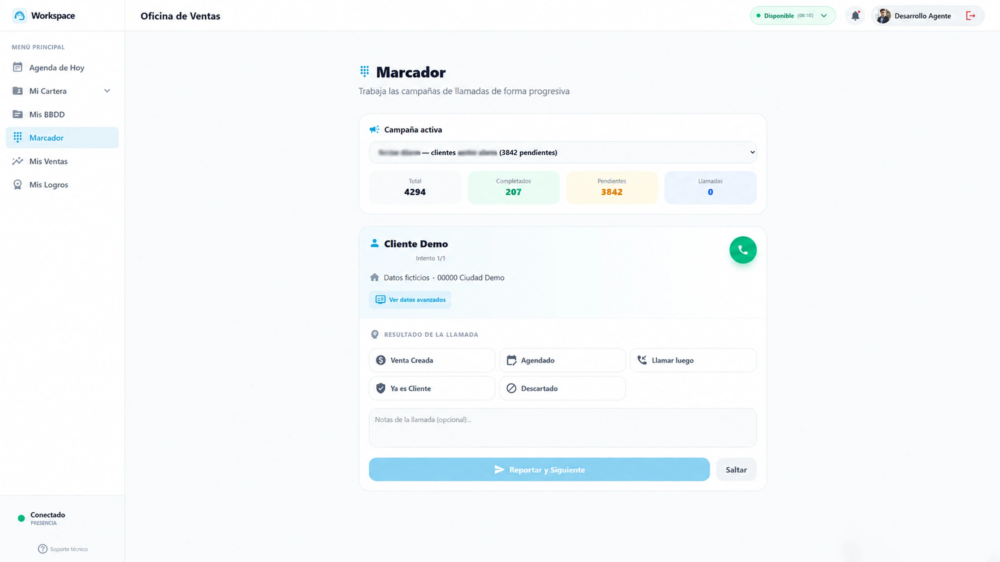
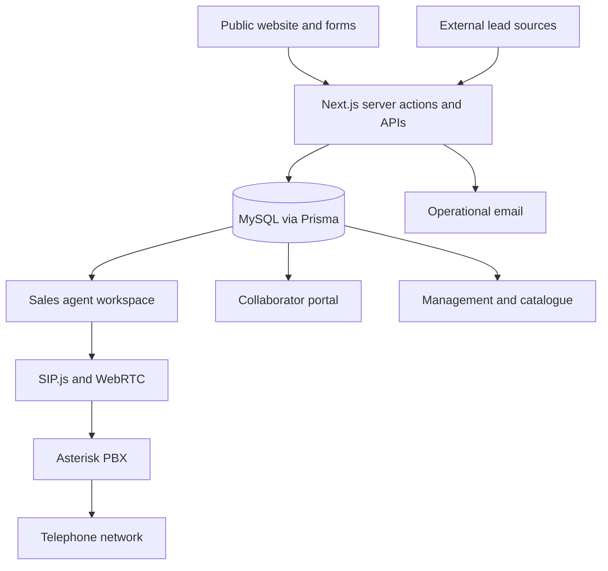

# ConectaYa · commercial platform

I designed and developed a platform that connects public lead capture, a service catalogue, sales operations, collaborators and browser-based telephony. It was deployed during my work at ConectaYa.

**My role:** application architecture, fullstack development and integrations. **Stack:** TypeScript, Next.js, React, Prisma, MySQL, NextAuth.js, SIP.js/WebRTC and Asterisk.

By the end of my time at ConectaYa in **August 2026**, the platform held **100,000+ leads** and supported **40+ active call centre agents and collaborators**. These figures describe the scale of the platform during my work there.

[Product case study and screenshots](https://www.ricardohuertas.es/trabajos/conectaya/) · [About my work](https://www.ricardohuertas.es/)

*Sales workspace with demonstration data.*

## The problem

Lead acquisition, catalogue maintenance, agent work and collaborator commissions need to stay connected. A contact entering through a form or API must reach an accountable owner, and a sale must remain traceable to the product and collaborator involved.

I worked on the public comparison/capture experience and the internal platform: lead assignment, role-specific workspaces, sales and commission records, document flows and a contact centre inside the browser.

## Architecture

## Engineering decisions

**Permissions belong on the server.** Managers, agents and collaborators have different responsibilities. Role checks are applied to server operations as well as the interface, including restrictions on settings and lead notification preferences.

**Use a relational model for operational history.** Leads, users, products, sales, commissions, assignments and calls are related records. Prisma/MySQL gives those relationships an explicit schema instead of scattering business state across separate spreadsheets.

**Put calling in the agent's workflow.** SIP.js/WebRTC connects the browser to Asterisk. The application also needs queue state, call outcomes and retry rules so the next action stays attached to the lead. A telephony integration is more than a call button.

**Connect the collaborator portal to the same business records.** Lead submission, documents, signatures and commission tracking need consistent identifiers and permissions across roles.

## Verification

The private repository includes automated tests for application behaviour and permissions.

Built during my work at ConectaYa, ending in August 2026. This repository contains the technical case study and a screenshot with demonstration data; application source is private.
