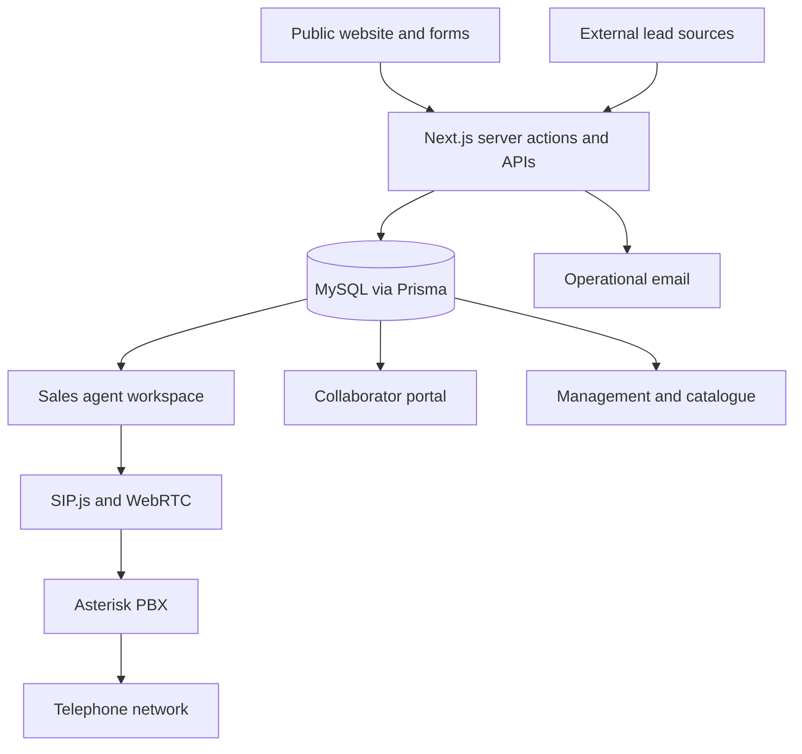

# ConectaYa · commercial platform

I designed and developed a platform that connects public lead capture, a service catalogue, sales operations, collaborators and browser-based telephony. It was deployed during my work at ConectaYa.

**My role:** application architecture, fullstack development and integrations. **Stack:** TypeScript, Next.js, React, Prisma, MySQL, NextAuth.js, SIP.js/WebRTC and Asterisk.

[Product case study and screenshots](https://www.ricardohuertas.es/trabajos/conectaya/) · [About my work](https://www.ricardohuertas.es/)

*Product interface with a demonstration contact. The image illustrates the workflow; displayed counters are not a benchmark or a current usage report.*

## The problem

Lead acquisition, catalogue maintenance, agent work and collaborator commissions need to stay connected. A contact entering through a form or API must reach an accountable owner, and a sale must remain traceable to the product and collaborator involved.

I worked on the public comparison/capture experience and the internal platform: lead assignment, role-specific workspaces, sales and commission records, document flows and a contact centre inside the browser.

## Architecture

## Engineering decisions

**Permissions belong on the server.** Managers, agents and collaborators have different responsibilities. Role checks are applied to server operations as well as the interface, including restrictions on settings and lead notification preferences.

**Use a relational model for operational history.** Leads, users, products, sales, commissions, assignments and calls are related records. Prisma/MySQL gives those relationships an explicit schema instead of scattering business state across separate spreadsheets.

**Put calling in the agent's workflow.** SIP.js/WebRTC connects the browser to Asterisk. The application also needs queue state, call outcomes and retry rules so the next action stays attached to the lead. A telephony integration is more than a call button.

**Connect the collaborator portal to the same business records.** Lead submission, documents, signatures and commission tracking need consistent identifiers and permissions across roles.

## Verification and boundaries

The private repository includes automated tests for application behaviour and permissions. This public case documents the design and shows selected product screens; it does not expose the operational code or execute those private tests.

My work on the project ended in August 2026. This is a record of the system I built, not a statement about its current maintenance, availability or commercial performance. Usage figures from different dates are deliberately omitted here.

I integrated existing frameworks and services; I did not create Next.js, Prisma, Asterisk or the external messaging platforms. The operational repositories, customer records and credentials remain private.

## Read this case

This repository contains documentation and a selected screenshot only. There is no application to install.

The screenshot and case text are portfolio material. Third-party names and product marks belong to their respective owners; this repository does not grant a licence to the underlying application.
